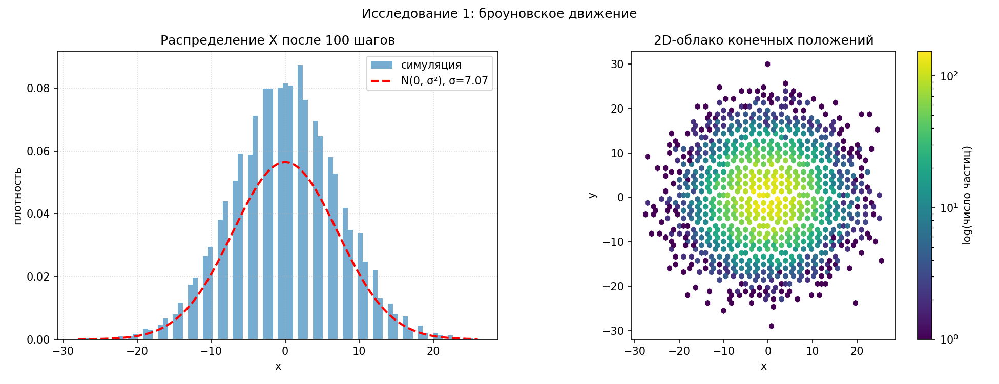
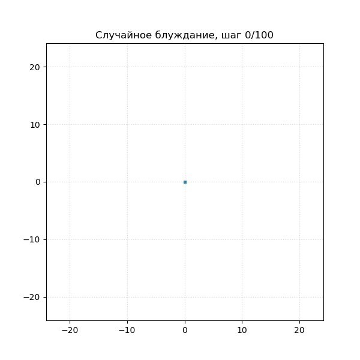
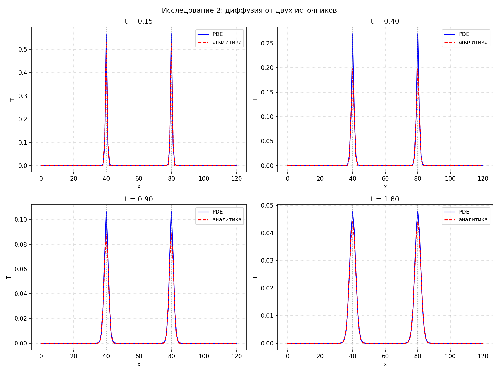
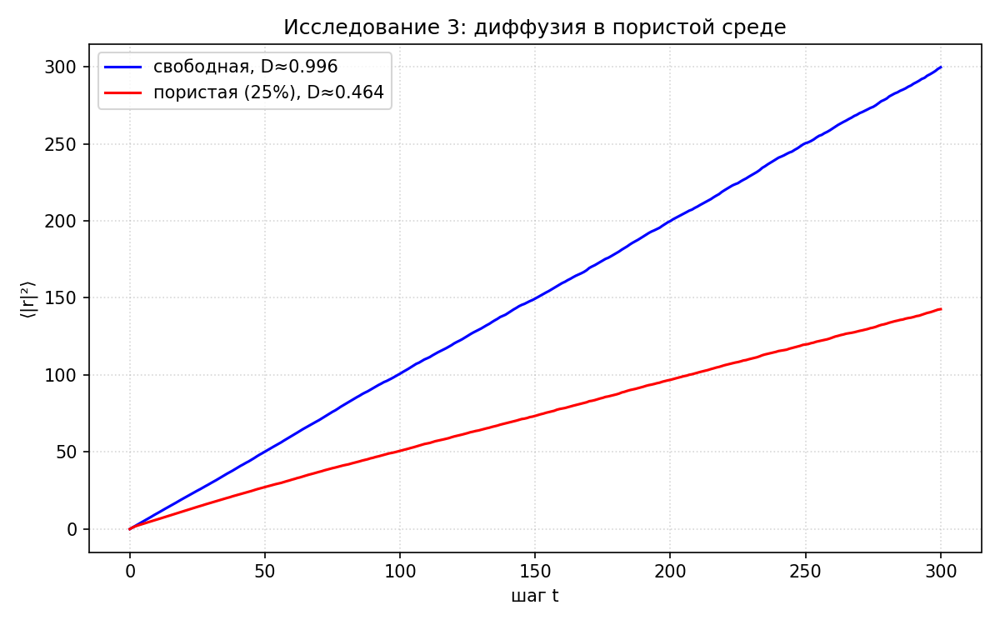

# Моделирование диффузии: стохастическая и детерминированная модели

Проект по дисциплине «Компьютерное моделирование» (МГТУ им. Н.Э. Баумана, кафедра СМ-6).

Реализованы две взаимодополняющие модели диффузии:

- **Стохастическая** — случайное блуждание (Монте-Карло);
- **Детерминированная** — явная конечно-разностная схема уравнения теплопроводности.

Проведены четыре физических исследования: броуновское движение, суперпозиция двух источников, диффузия в пористой среде, температурная зависимость коэффициента диффузии (закон Аррениуса).

## Теоретическая часть

### Стохастическая модель (случайное блуждание)

Каждая $i$-я частица имеет текущее положение $\vec{r}_i$ и за один шаг смещается на расстояние $\delta$ в одном из четырёх равновероятных направлений:

$$
\vec{r}_i^{\,k} = \vec{r}_i^{\,k-1} + \Delta\vec{r}, \qquad \Delta\vec{r} \in \{(+\delta, 0),\ (-\delta, 0),\ (0, +\delta),\ (0, -\delta)\}.
$$

Среднее положение не меняется, а дисперсия растёт линейно со временем (закон Эйнштейна–Смолуховского):

$$
\sigma_x^2 = k\,\delta^2 = \frac{\delta^2}{\Delta t}\, t = 2Dt,
$$

где $D = \delta^2/(2\Delta t)$ — коэффициент диффузии.

Согласно центральной предельной теореме, распределение координат стремится к нормальному:

$$
p(x) = \frac{1}{\sqrt{2\pi}\,\sigma_x}\exp\left(-\frac{x^2}{2\sigma_x^2}\right).
$$

### Детерминированная модель (уравнение теплопроводности)

Для континуального описания используется двумерное уравнение диффузии:

$$
\frac{\partial T}{\partial t} = \kappa\left(\frac{\partial^2 T}{\partial x^2} + \frac{\partial^2 T}{\partial y^2}\right),
$$

где $T(x,y,t)$ — концентрация, $\kappa$ — коэффициент диффузии.

Явная конечно-разностная схема:

$$
T_{i,j}^{k+1} = T_{i,j}^{k} + \frac{\kappa\Delta t}{\Delta x^2}\left(T_{i+1,j}^{k} - 2T_{i,j}^{k} + T_{i-1,j}^{k}\right) + \frac{\kappa\Delta t}{\Delta y^2}\left(T_{i,j+1}^{k} - 2T_{i,j}^{k} + T_{i,j-1}^{k}\right).
$$

Условие устойчивости:

$$
\frac{\kappa\Delta t}{\Delta x^2} \le \frac{1}{4}.
$$

Аналитическое решение для гауссова источника ширины $\sigma_0$ (сечение вдоль оси $X$ при $y=0$):

$$
T(x,t) = \frac{1}{2\pi s^2}\exp\left(-\frac{x^2}{2s^2}\right), \qquad s^2 = 2\kappa t + \sigma_0^2.
$$

### Модель thermally-activated диффузии (закон Аррениуса)

Вероятность прыжка частицы за один шаг:

$$
p_{\text{jump}} = \exp\left(-\frac{E_a}{k_B T}\right),
$$

что приводит к аррениусовской зависимости:

$$
D(T) = D_0\exp\left(-\frac{E_a}{k_B T}\right).
$$

### Модель пористой среды

Среда моделируется случайной маской препятствий на периодической решётке. Частица, пытающаяся попасть в узел с препятствием, остаётся на месте:

$$
\vec{r}_i^{\,k} = \begin{cases} \vec{r}_i^{\,k-1} + \Delta\vec{r}, & \text{узел свободен}, \\ \vec{r}_i^{\,k-1}, & \text{узел занят}. \end{cases}
$$

Эффективный коэффициент диффузии оценивается по формуле Бруттье–Эмта:

$$
D_{\text{eff}} = D_0(1-f)^2,
$$

где $f$ — доля препятствий.

## Интерфейс

```bash
python dif.py gif-walk -n 300 -s 200 --seed 42 -o walk.gif
python dif.py gif-pde -s 400 --save-every 3 -o diff.gif
python dif.py gif-pde --source two -s 500 --save-every 3 -o diff_two.gif
python dif.py study all
python dif.py physics all
## Базовые GIF

Случайное блуждание — облако из 300 частиц расползается за 200 шагов:


Диффузия от одного источника — расширяющееся пятно:


Диффузия от двух источников — суперпозиция:


## Броуновское движение

Гистограмма координат после 100 шагов с теоретической гауссианой и 2D-облако 20 000 частиц:


Анимация 200 частиц за 100 шагов:


Результат: $\sigma_x^{\text{сим}}/\sigma_x^{\text{теор}} = 1.010$.

## Диффузия от двух источников

Профили концентрации вдоль оси $X$ на четырёх временных срезах:


Анимация эволюции поля $T(x,y,t)$:


## Диффузия в пористой среде

Среднеквадратичное смещение в свободной среде и с 25% препятствий:


Анимация траектории в пористой среде:


## Закон Аррениуса

Аррениусовский график $\ln D$ от $1/T$:


## Валидация PDE

Сравнение численного решения с аналитикой на четырёх срезах:


## Закон Эйнштейна–Смолуховского

Среднеквадратичное смещение со временем:
