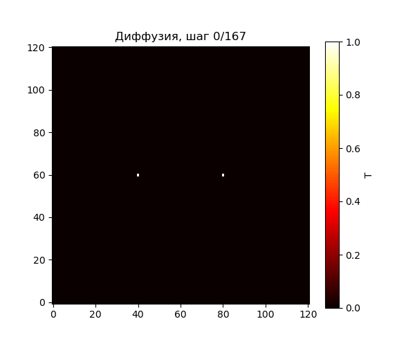
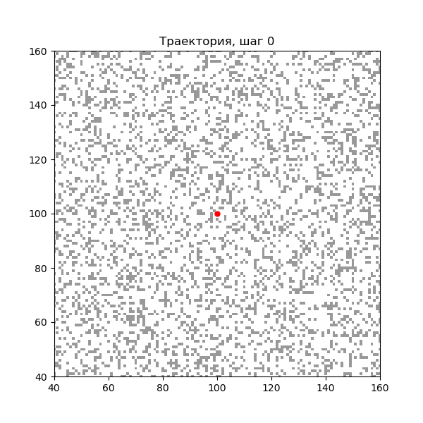
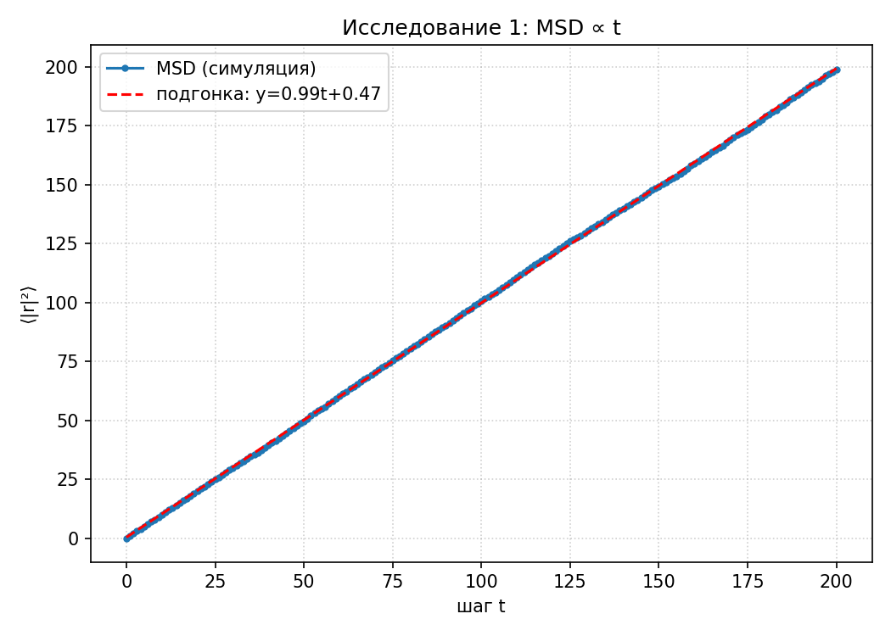

# Моделирование диффузии

Проект по дисциплине «Компьютерное моделирование» (МГТУ им. Н.Э. Баумана, кафедра СМ-6).

Две модели диффузии: стохастическая (случайное блуждание) и детерминированная (уравнение теплопроводности).

## Теоретическая часть

### Случайное блуждание

$$\sigma_x^2 = k\delta^2 = 2Dt, \quad D = \delta^2/(2\Delta t).$$

$$p(x) = \frac{1}{\sqrt{2\pi}\sigma_x}\exp\left(-\frac{x^2}{2\sigma_x^2}\right).$$

### Уравнение теплопроводности

$$\frac{\partial T}{\partial t} = \kappa\left(\frac{\partial^2 T}{\partial x^2} + \frac{\partial^2 T}{\partial y^2}\right).$$

$$T(x,t) = \frac{1}{2\pi s^2}\exp\left(-\frac{x^2}{2s^2}\right), \quad s^2 = 2\kappa t + \sigma_0^2.$$

### Закон Аррениуса

$$D(T) = D_0\exp\left(-E_a/(k_B T)\right).$$

### Пористая среда

$$D_{\text{eff}} = D_0(1-f)^2.$$

## Базовые GIF

### Случайное блуждание


### Диффузия — один источник


### Диффузия — два источника



## Исследование 1 — броуновское движение


Результат: sigma_x(сим)/sigma_x(теор) = 1.010.

## Исследование 2 — два источника


## Исследование 3 — пористая среда




Результат: D_obs/D_free = 0.466 vs (1-f)^2 = 0.56.

## Исследование 4 — закон Аррениуса


Результат: E_a(оцен) = 0.952 при заданном 1.0, ошибка 4.77%.

## PDE vs аналитика


## MSD пропорционально t



## Запуск

``````
pip install numpy matplotlib pillow
python dif.py --help
python dif.py study all
python dif.py physics all
``````
